This project implements a serverless asset delivery pipeline on AWS for hosting and delivering a static web application. It uses Amazon S3 as a managed object storage service to store the application's static files, including HTML pages and media assets, while Amazon CloudFront delivers the content to users through a globally distributed Content Delivery Network (CDN), demonstrating how managed AWS services can be combined to build a secure, scalable, cost conscious, and serverless static asset delivery pipeline


## Architecture Diagram

                      [ Internet Users ]
                               │
                               │ HTTPS (Port 443)
                               ▼
                     ┌────────────────────┐
                     │  Amazon CloudFront │
                     │   (Edge Network)   │
                     └─────────┬──────────┘
                               │
                               │ Origin Access Control (OAC)
                               ▼
                     ┌────────────────────┐
                     │ Private S3 Bucket  │
                     │ (Media & Web Files)│
                     └────────────────────┘


## Implementation Steps

## Create the Private S3 Bucket and Upload Content

- Provision a private S3 bucket with **Block All Public Access** and **Bucket Versioning** enabled. Block All Public Access prevents public access to the bucket, while the S3 bucket policy restricts access to the authorized CloudFront distribution using Origin Access Control (OAC). Bucket Versioning preserves previous versions of objects, enabling recovery from accidental deletions or overwrite

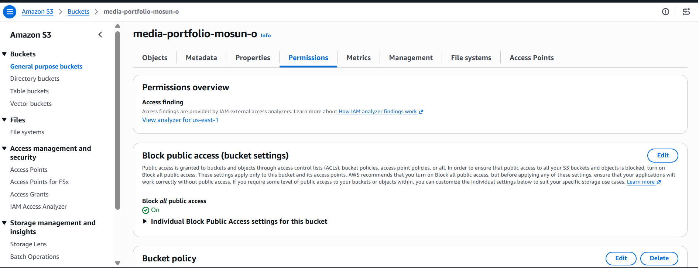

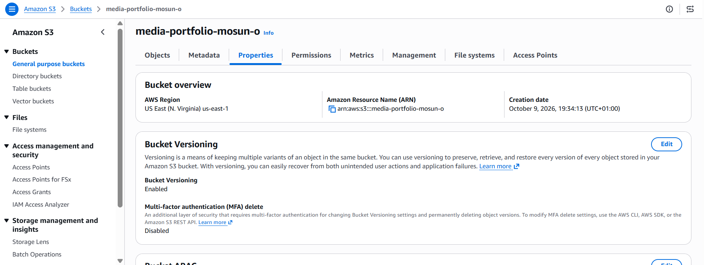

- Upload a static web application consisting of index.html which serves as the entry point and main page of the application, error.html which provides a custom error page for displaying error messages, and an assets/ folder that contains the application's static media files

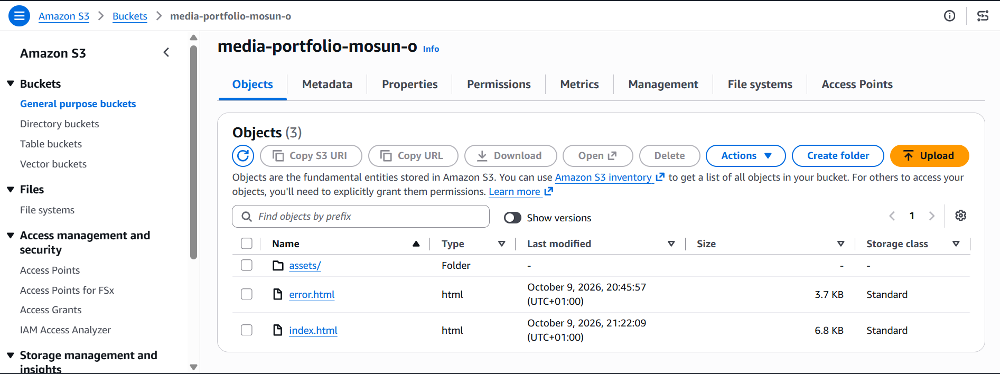

## Set Up CloudFront with Origin Access Control (OAC)

- Create a CloudFront distribution with Origin Access Control(OAC) configured for the S3 bucket origin. Configure the distribution to redirect HTTP requests to HTTPS to ensure secure access to the website, and set index.html as the default root object so that it is served when users access the distribution's root URL

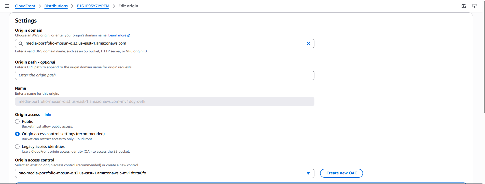

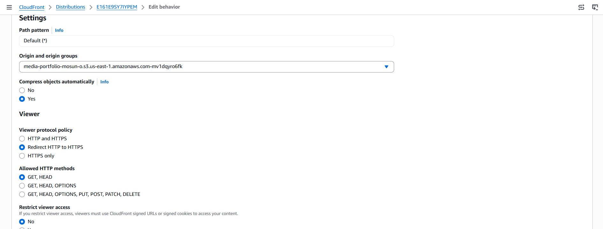

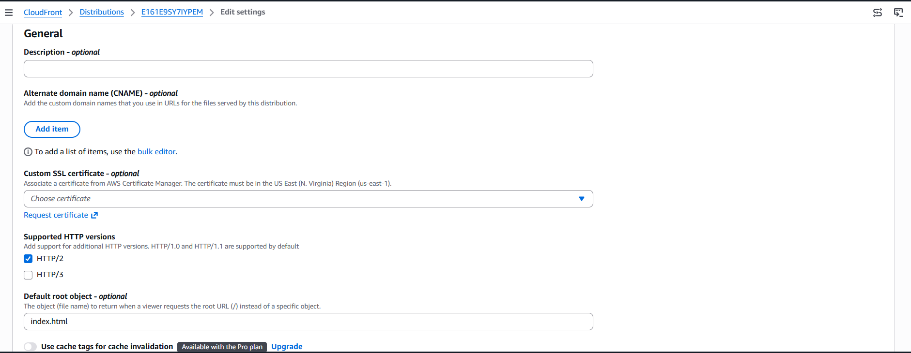

- Ensure that the S3 bucket policy grants access only to the authorized CloudFront distribution 

```
{
	"Version": "2008-10-17",
	"Id": "PolicyForCloudFrontPrivateContent",
	"Statement": [
		{
			"Sid": "AllowCloudFrontServicePrincipal",
			"Effect": "Allow",
			"Principal": {
				"Service": "cloudfront.amazonaws.com"
			},
			"Action": "s3:GetObject",
			"Resource": "arn:aws:s3:::media-portfolio-mosun-o/*",
			"Condition": {
				"ArnLike": {
					"AWS:SourceArn": "arn:aws:cloudfront::834863651662:distribution/E161E9SY7IYPEM"
				}
			}
		}
	]
}
```

## Configure S3 Lifecycle Rules and Test the CloudFront Distribution URL

- The S3 lifecycle rule manages the application's media files by automatically transitioning objects between different S3 storage classes to optimize storage costs

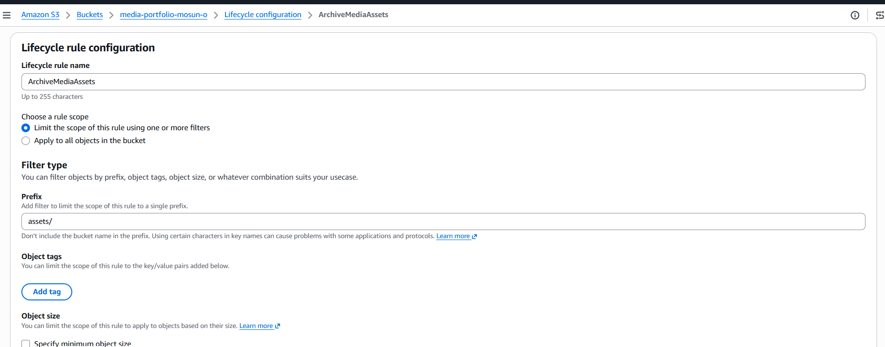

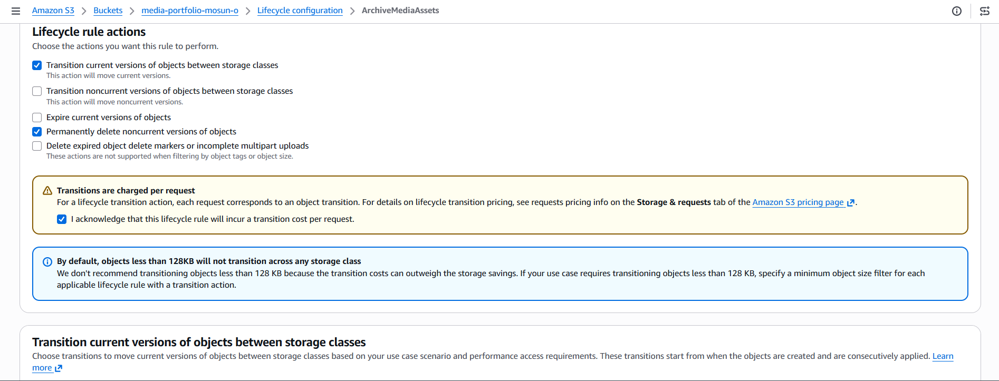

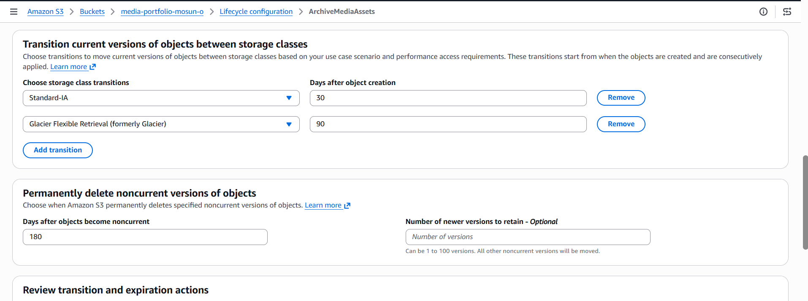


- Copy the CloudFront distribution domain name from the Distributions tab and open it in a web browser to verify that the application content is served correctly over HTTPS through CloudFront

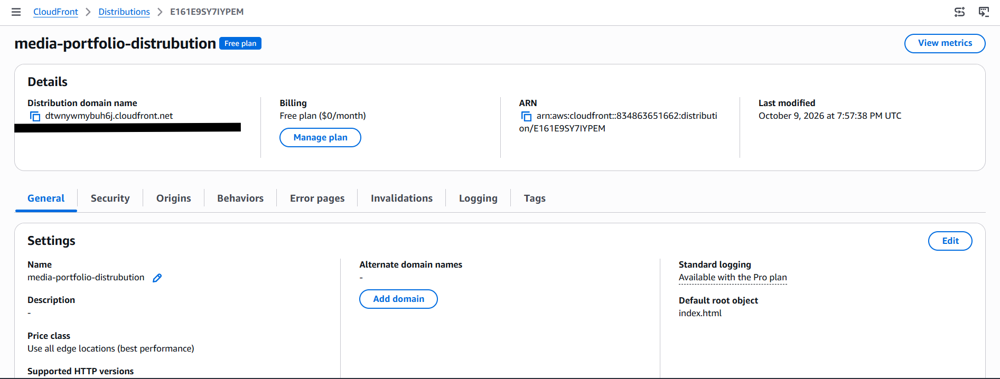


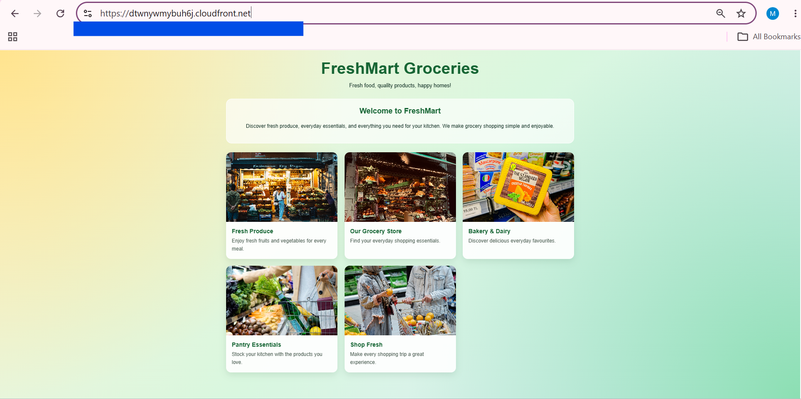


