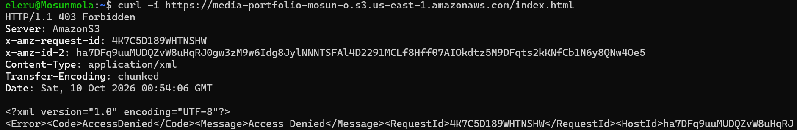
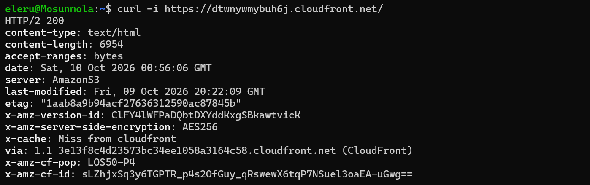

## Live Demo

Access the application website served through CloudFront over HTTPS: [Visit the Website](https://dtwnywmybuh6j.cloudfront.net/)

## S3 Access Forbidden (403)

Attempt to access the S3 bucket directly to verify that a 403 Forbidden response is returned confirming that public access is blocked and the bucket remains private




## CloudFront Success (HTTP 200)

This confirms that CloudFront successfully retrieves and delivers the website content from the S3 origin to users




## S3 Bucket Policy

The S3 bucket policy restricts access to the authorized CloudFront distribution through Origin Access Control (OAC), keeping the bucket private and preventing direct public access

```
{
	"Version": "2008-10-17",
	"Id": "PolicyForCloudFrontPrivateContent",
	"Statement": [
		{
			"Sid": "AllowCloudFrontServicePrincipal",
			"Effect": "Allow",
			"Principal": {
				"Service": "cloudfront.amazonaws.com"
			},
			"Action": "s3:GetObject",
			"Resource": "arn:aws:s3:::media-portfolio-mosun-o/*",
			"Condition": {
				"ArnLike": {
					"AWS:SourceArn": "arn:aws:cloudfront::834863651662:distribution/E161E9SY7IYPEM"
				}
			}
		}
	]
}
```


